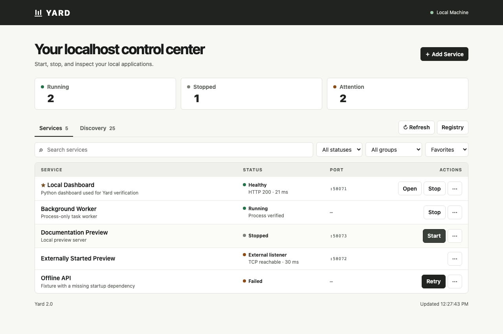

# Yard

Yard is a local control center for development services. Start, stop, restart,
and open applications from one browser tab. The registry includes stopped
services, and Discovery shows listeners and candidate projects you can register.



## Install and open

Yard uses Kujo 1.5.0 or newer, Python 3.8 or newer, Bash, `lsof`, `ps`, and
`curl`. Git is used to identify project roots. This release was verified on
macOS. The dashboard requires no asset build.

```sh
git clone https://github.com/robertdevore/yard.git
cd yard
mkdir -p "$HOME/.local/bin"
ln -s "$PWD/bin/yard" "$HOME/.local/bin/yard"
export PATH="$HOME/.local/bin:$PATH"
yard
```

Yard opens [the local dashboard](http://127.0.0.1:9753). Open it again by running
`yard` or `yard open`. Closing the tab leaves Yard and your services running.
For a foreground server, run `yard serve` and open the printed address.

## Commands

| Command | Purpose |
| --- | --- |
| `yard` or `yard open` | Launch or reuse the dashboard and open a browser |
| `yard serve [port]` | Serve the dashboard in the foreground on loopback |
| `yard scan [--json] [--no-health]` | List registered services and local listeners |
| `yard start <id>` | Start a registered service and verify readiness |
| `yard stop <id>` | Gracefully stop a Yard-owned service |
| `yard restart <id>` | Stop, verify release, then start and verify readiness |
| `yard stop <id> --force --yes` | Force Stop a verified, non-sensitive Yard-owned group |
| `yard open <id>` | Open a service URL |
| `yard config path`, `yard config show` | Print the registry path or validated configuration |
| `yard doctor [--json]` | Check runtime tools, registry, state, and dashboard port |
| `yard version`, `yard help` | Print version or help |

Default files live under `~/.config/yard/`. To use an existing registry in place,
run `yard --config /absolute/path/yard.config.json`. Add
`--state /absolute/path/.yard` if you want to retain its existing logs.
See the registry guide for path precedence and legacy compatibility.

## Guides

- [User guide](docs/USER_GUIDE.md)
- [Local development ports](docs/LOCAL_PORTS.md)
- [Registry format and migration](docs/SERVICE_REGISTRY.md)
- [Process lifecycle and recovery](docs/PROCESS_LIFECYCLE.md)
- [Architecture and API](docs/ARCHITECTURE.md)
- [Security and operating boundaries](docs/SECURITY.md)
- [Adjacent applications and launch inventory](docs/LOCAL_SERVICE_INVENTORY.md)
- [Testing and performance](docs/TESTING.md)
- [Implementation report](docs/IMPLEMENTATION_REPORT.md)
